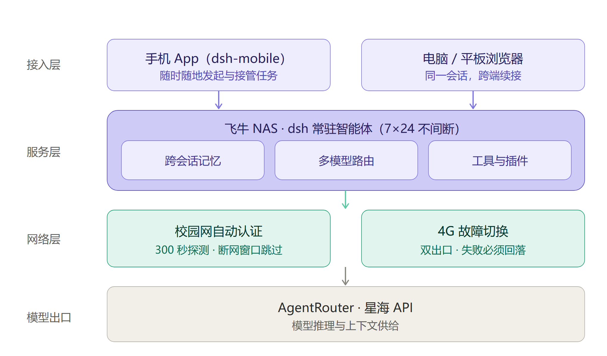
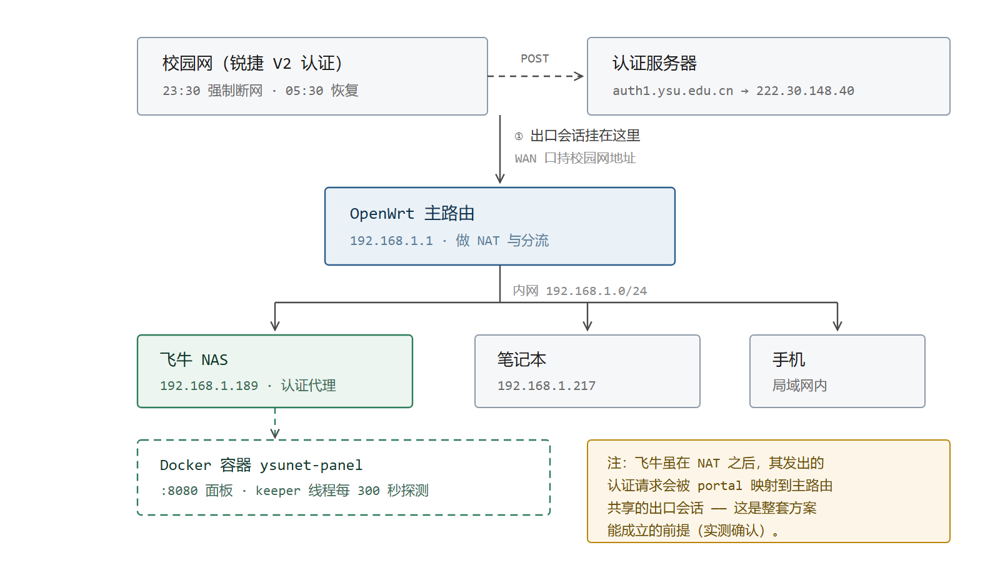
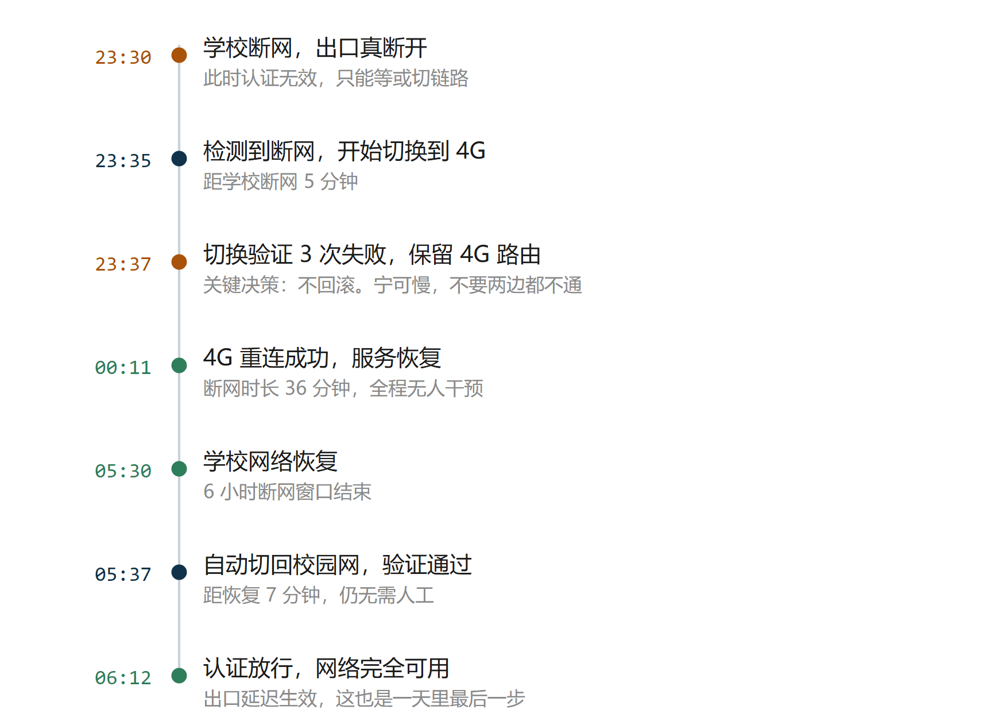

# 个人 AI 智能体栈

> 让 AI 从对话框搬到常驻服务器上：7×24 在线、有记忆、手机随时接管。

这不是一个模型项目，而是一套**让 AI 服务一直活着**的基础设施。四个模块都可以独立使用，拼在一起时，它们共同回答一个问题：当宿主网络每晚都会断、当出口随时可能失效、当你人不在电脑前，一个"个人 AI 助手"要怎样才能真的在跑。

实测环境：一台退役的 Xeon E3-1220 V2，15 GB 内存，跑 fnOS（Debian 12），日常功耗约 60 W。

## 为什么需要这些"周边"

模型能力不是瓶颈，**可用性才是**。

| 约束 | 表现 | 后果 |
|---|---|---|
| 校园网每晚 23:30 强制断网、次日 05:30 恢复 | 恢复后每台设备都要重新认证 | 早上没人醒来登录，服务整夜躺平 |
| 链路白天也会无征兆掉线 | 认证程序自己也无能为力 | 请求全部超时 |
| 人不在电脑前 | 只有手机 | 看不到进度，也没法指挥 |

于是有了三层保障，加上顶层的接入与模型出口：

## 架构



| 层 | 解决什么 | 由谁承担 | 对应模块 |
|---|---|---|---|
| 接入层 | 人不在电脑前也能指挥 | dsh-mobile App、浏览器 | `dsh-loopback-proxy` |
| 服务层 | 智能体持续在线、有记忆 | dsh 运行时 + 插件 | — |
| 网络层 | 链路断了能自己恢复 | 认证守护 + 双出口切换 | `ysunet-auto-login`、`wan-failover`、`stick-panel` |
| 模型出口 | 模型能力供给 | AgentRouter 等中转 | — |

物理部署：



关键前提：认证程序虽然跑在 NAT 之后的 NAS 上，但它发出的认证请求会被 Portal 映射到主路由那条共享的出口会话——所以它能替整个内网完成登录。这一点已实测确认。

## 模块

| 模块 | 职责 | 依赖 | 部署形态 |
|---|---|---|---|
| [`ysunet-auto-login`](./ysunet-auto-login) | 锐捷 V2 自动认证，掉线自动重连，带 Web 面板 | Docker | NAS 容器 |
| [`wan-failover`](./wan-failover) | 主线路不通切 4G，恢复后切回，绝不半切换 | bash + iproute2 | systemd timer |
| [`stick-panel`](./stick-panel) | 4G 随身 WiFi 的 Web 面板，链路逐跳可见 | Flask + paramiko | NAS 容器 |
| [`dsh-loopback-proxy`](./dsh-loopback-proxy) | 让局域网设备访问只信任回环的管理接口 | Python 标准库 | systemd 服务 |

四个模块彼此**不依赖**，可以只挑需要的用：

```
认证   →  保证校园网会话有效
切换   →  保证出口断了还有备线
面板   →  保证备线自己能被人管
代理   →  保证人在外面也能接管服务
```

## 部署顺序

```bash
# 1. 校园网自动认证（先保证白天不会莫名掉线）
cd ysunet-auto-login && cp .env.example .env && vi .env
docker compose up -d

# 2. 双出口切换（夜间断网时的兜底）
sudo install -m 755 wan-failover/wan-failover.sh /usr/local/bin/
sudo cp wan-failover/wan-failover.{service,timer} /etc/systemd/system/
# 编辑 service 填入 STICK_PASS，再：
sudo systemctl enable --now wan-failover.timer

# 3. 随身 WiFi 面板（能远程管备线）
cd stick-panel && cp .env.example .env && vi .env
docker compose up -d

# 4. 回环代理（让手机/别的电脑能访问管理接口）
sudo cp dsh-loopback-proxy/dsh-loopback-proxy.service /etc/systemd/system/
sudo systemctl enable --now dsh-loopback-proxy
```

每一步的细节、配置项和踩坑记录，看各模块自己的 README。

## 一次无人值守的夜晚



那一夜：23:30 学校断网 → 23:35 脚本检测到并切 4G → 23:37 切换验证失败但**保留** 4G 路由 → 00:11 4G 重连成功 → 05:30 学校恢复 → 05:37 自动切回 → 06:12 认证放行。全程无人干预。

## 几个关键设计

**探测用 HTTPS，不用 HTTP。** 断网时强制门户会劫持所有 HTTP 请求并返回 200，页面其实是认证页。HTTPS 没有目标站点证书，握手直接失败，判断才准。

**切换失败不回滚。** 验证失败时保留备线路由，而不是退回主线路。回滚会把代理内核的出站绑在一个已经死掉的接口上，结果比不切换更糟——宁可慢，不要"两边都不通"。

**补丁不如绕过。** 给上游改代码，每次升级都要重打一遍，那是负债；用不改动上游文件的代理，升级不受影响。判断标准：这个改动升级之后还在不在。

**日志按时间读，不要按行读。** 连续六行"认证失败"可能意味着第一次就成功了，只是出口放行有延迟。孤立看一行，几乎总会得出错误结论。

## 目录

```
.
├── docs/                    架构图、拓扑图、事件时间线
├── ysunet-auto-login/       校园网自动认证（Docker + Web 面板）
├── wan-failover/            双出口自动切换
├── stick-panel/             随身 WiFi Web 面板
└── dsh-loopback-proxy/      回环身份代理
```

## 也可以单独取用

四个模块各自有独立仓库，只想用其中一个的话：

- [ysunet-auto-login](https://github.com/LzBsA/ysunet-auto-login)
- [wan-failover](https://github.com/LzBsA/wan-failover)
- [stick-panel](https://github.com/LzBsA/stick-panel)
- [dsh-loopback-proxy](https://github.com/LzBsA/dsh-loopback-proxy)

## 许可

MIT。`ysunet-auto-login/ysu_net_login/` 来自 [KamijoToma/YSUNetLoginv2](https://github.com/KamijoToma/YSUNetLoginv2)，版权归原作者。

## 免责

仅供个人学习与自用。请遵守所在学校的网络使用规定，不要用于绕过计费、多设备共享等用途。`wan-failover` 会修改系统路由表，请在能物理接触到机器的环境里先测试。
