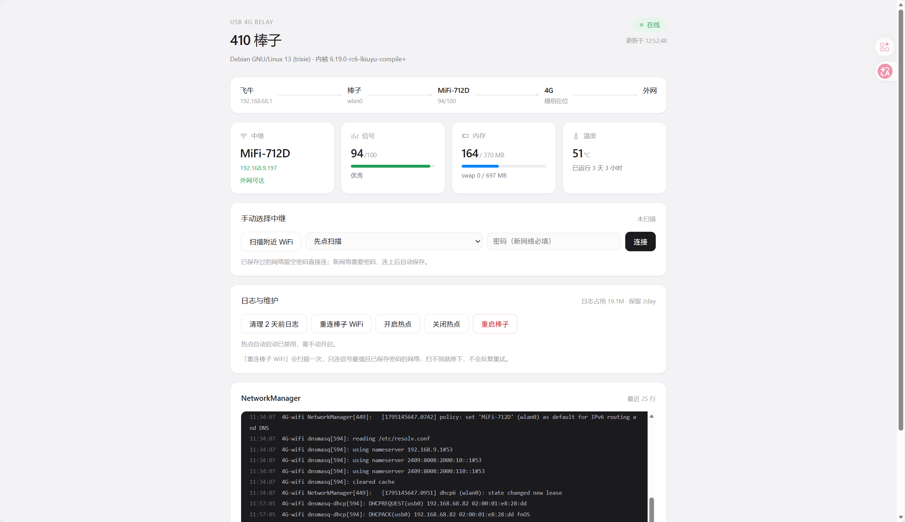

# stick-panel

一根 4G 随身 WiFi 棒（高通 410 / Debian）的 Web 管理面板。Flask + paramiko，通过 SSH 抓取状态，一个页面看全。



## 功能

- **链路拓扑**：飞牛 → 棒子 → 中继 → 4G → 外网，逐跳显示通断，一眼看出断在哪一段
- **状态卡片**：中继名称与 IP、信号强度、内存占用、温度、运行时长
- **换中继**：扫描附近 WiFi，扫码/填密码直接切换，自动存为默认
- **维护操作**：清日志、重连 WiFi、开关热点、重启设备
- **实时日志**：NetworkManager 最近 25 行，不用 SSH

## 快速开始

```bash
cp .env.example .env
vi .env                    # 填 4G 棒的地址和密码

docker compose up -d
```

打开 `http://<你的IP>:8090`。

不走 Docker 也可以：

```bash
pip install -r requirements.txt    # flask, paramiko
STICK_HOST=192.168.68.1 STICK_PASS=你的密码 python app.py
```

## 配置

| 环境变量 | 说明 | 默认 |
|---|---|---|
| `STICK_HOST` | 4G 棒的地址 | `192.168.68.1` |
| `STICK_USER` | SSH 用户 | `root` |
| `STICK_PASS` | SSH 密码 | **必填，无默认值** |

## 实现说明

- 状态通过一条组合 shell 命令一次性抓回（`/proc/meminfo`、`thermal_zone0`、`nmcli`、`mmcli`、`journalctl --disk-usage`），避免多次 SSH 往返
- 结果缓存 5 秒，页面轮询不会把棒子压垮
- 数字字段做了容错解析，棒子固件差异导致的字段缺失不会让整页崩掉

## 注意

**这是给内网用的。** 面板没有任何鉴权，密码是明文存在环境变量里传给 paramiko 的——只适合放在受信任的局域网中，不要暴露到公网。

不同固件的 410 棒子命令输出格式有差异，`COLLECT` 那段脚本可能需要按你的设备微调。

## 许可

MIT。
